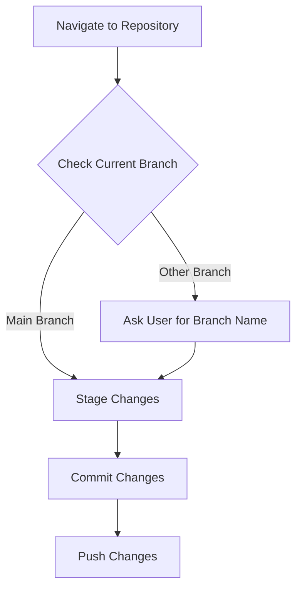

# Plan to Sync and Push Changes to GitHub

This plan outlines the steps to sync and push changes to the GitHub repository located at `https://github.com/username/myrepo.git`.  The repository path is assumed to be `./myrepo`.

**Steps:**

1. **Navigate to the Git repository:**  Change the working directory to `./myrepo`.
2. **Check the current branch:** Use the command `git branch` to determine the current branch. If it is not `main`, you will need to determine the correct branch name to push to.
3. **Stage changes:** Use the command `git add .` to stage all changes.
4. **Commit changes:** Use the command `git commit -m "Sync and push"` to commit the staged changes.
5. **Push changes:** Use the command `git push -u origin main` (or the appropriate branch name) to push the committed changes to the remote repository.

**Diagram:**

**Assumptions:**

* A Git repository exists at `./myrepo`.
* The remote repository is correctly configured.
* Standard Git workflow is being used.

**Error Handling:**

If any errors occur during the process (e.g., merge conflicts), you will need to resolve them before proceeding.